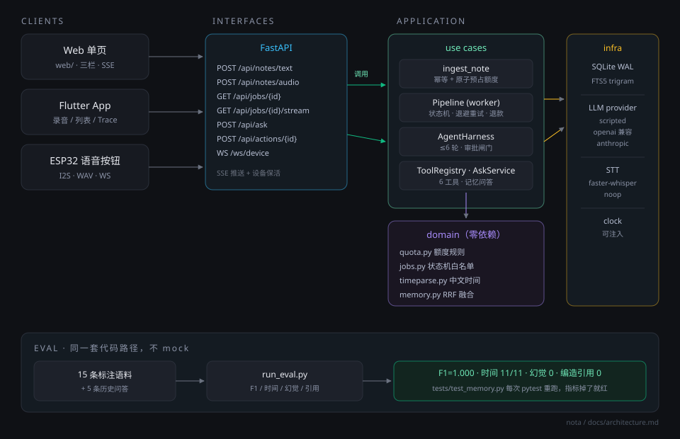

# Nota

> 随口说一句，剩下的我来：把一段语音变成**摘要 + 待办 + 提醒**，并且真的替你**动手办**（建待办、设提醒、记日历）。
>
> 「2026 AI Builder」Part B 实现。Part A 的设计判断与这里的落地对应关系见 `docs/part-a.md`。

## 架构与取舍（题面要求 ≤300 字）

分层：domain（纯逻辑，不依赖框架）/ application（用例）/ infrastructure（SQLite、LLM、STT）/ interfaces（HTTP）。一次请求：落库与占额度在同一事务，幂等键去重，worker 异步做转写与 Agent 循环，不可逆工具挂起等人工审批。三处刻意取舍：Python 而非 Rust、SQLite 而非 Postgres、FTS5 加字符 n-gram 而非向量库——都是为了「clone 即跑、离线可验收」；代价是单机部署、语义检索偏弱，已把这些边界留成可替换的接口。

<p align="center">
  
</p>

## 60 秒跑起来

```powershell
# Windows PowerShell。只需要 Python 3.10+，不需要任何 API Key。
.\run.ps1
# 打开 http://127.0.0.1:8787
```

```bash
# macOS / Linux
python -m venv .venv && . .venv/bin/activate
pip install -r requirements.txt
python -m backend.main
```

首次启动会自动建库、建表。**默认是 demo 模式**：用确定性本地规划器跑通「录音 → 转写 → Agent 工具调用 → 结果」整条链路，不联网、不花钱、可重复。

想接真模型：`cp .env.example .env`，填 `OPENAI_API_KEY` / `OPENAI_MODEL`（或 Anthropic），把 `LLM_PROVIDER` 改成 `openai` / `anthropic`，重启即可。**同一套 harness、同一套工具、同一套 trace**，没有第二套代码路径。

## 它到底做了什么

| 你说 | 它做 |
|---|---|
| 明天下午三点提醒我给张总发报价单 | 建 1 条提醒（2026-11-10 15:00）+ 1 条待办，并写摘要 |
| 下周三上午十点跟设计团队评审新版原型 | 解析「下周三」为绝对时间，建待办 |
| 今天开了个会，聊了下季度排期 | **不建任何待办**，只写摘要（陈述不是任务） |
| 上次给张总的报价是多少 | 检索历史记录，带 `[note:...]` 引用回答；没记录就说没记录 |

界面上工具调用是可见的（右栏 Agent Trace），每一次运行的 `think / tool_call / observe` 都落库，刷新页面还在。

## 关键设计（也是这次面试的重点）

**额度 10 次/天，是真的 10 次。** 不是前端计数，不是内存变量。`usage_ledger` 是一张只追加的账本，`reserve` 是一条带条件的 `INSERT ... SELECT ... WHERE used < limit`，在 `BEGIN IMMEDIATE` 事务里执行——50 个并发请求打进来，正好 10 个成功（`tests/test_quota.py` 里有这个测试）。幂等键 `(user_id, date_local, job_id, reason)` 唯一，同一条录音重试不会扣两次；任务最终失败会写一条 `-1` 的退款记录。跨天按用户时区的自然日切分。

**不可逆操作必须人工确认。** 工具带 `risk(READ|WRITE|IRREVERSIBLE)`。`create_calendar_event` 是 IRREVERSIBLE，harness 不执行它，而是写进 `pending_actions` 挂起，等用户在界面上点「确认执行」。这是 Part A / T3 里我自己写下的那个担心（「权限与审批的矛盾」）的具体解法。

**Agent 循环有上限。** 最多 6 轮，每轮的超时和工具调用都记录在 `agent_steps`。没有「无限自我反思」这种在 demo 里好看、上线就烧钱的东西。

**历史问答不编。** 检索先跑，模型只拿到检索到的片段；检索不到就直接回答「没有记录」，**不调用模型**。回答里的 `[note:id]` 会被校验，指向不存在片段的引用会被标成 `grounded=false`。

## 验证

```powershell
.\scripts\verify.ps1     # 起服务 + 打 8 组端到端断言，全绿才算过
python -m pytest tests   # 39 项
python -m eval.run_eval  # 15 条标注语料 + 5 条历史问答
```

当前结果：

```
task extraction   F1=1.000  P=1.000  R=1.000  (15/15 cases clean)
time resolution   11/11 = 1.000
groundedness      citations ok=4, refusals ok=1, hallucinated=0
```

评估集不是一次性脚本，`tests/test_memory.py::test_eval_suite_is_green` 会在每次 `pytest` 时重跑它——改了 prompt 或检索逻辑导致编造待办/引错记录，测试会红。

### 怎么自证「10 次/天」是真的

不用信我说的，跑这三条：

```powershell
# 1) 并发 50 个请求，只应成功 10 个（tests/test_quota.py::test_concurrent_reserve_caps_at_limit）
python -m pytest tests/test_quota.py -v

# 2) 端到端：起服务后连打 11 次，第 11 次 HTTP 429（scripts/verify.ps1 的第 7 组断言）
.\scripts\verify.ps1

# 3) 手工：看健康检查里的 plan / 账本
curl.exe -H "X-User-Id: demo" http://127.0.0.1:8787/api/quota
# {"used":10,"limit":10,"remaining":0,"plan":"free"}
```

第 2 条里还有两个关键断言：同一个 `idempotency_key` 连发 5 次只扣 1 次；任务最终失败会退款，`used` 会减回去。

## 项目结构

```
backend/
  domain/          纯逻辑：额度规则、任务状态机、时间解析、记忆排序（无 I/O）
  application/     用例：ingest、pipeline、agent_harness、tools、ask、quota
  infrastructure/  SQLite、LLM provider、STT、schema
  interfaces/      FastAPI 路由、SSE、WebSocket、静态页
web/               三栏单页（无构建步骤）
app/nota_app/      Flutter 客户端
device/            ESP32 固件 + Wokwi 工程 + 虚拟设备
eval/              评估集与打分器
docs/              架构、ADR、硬件、数据库
```

分层是硬约束：`domain/` 不 import 任何框架，`application/` 不 import FastAPI，只有 `interfaces/` 知道 HTTP 长什么样。

## 硬件

`device/firmware/nota_button.ino` 是 ESP32 语音按钮固件（I2S 采音 → 打包 WAV → POST → 用灯色表达 Agent 状态）。Wokwi 工程在 `device/wokwi/`。因为没有 INMP441 的仿真模型，另附 `device/sim/virtual_device.py` 作为行为等价的虚拟设备，走同一套 HTTP + WebSocket 接口。详见 `docs/hardware.md`。

## Flutter 客户端

`app/nota_app/` 是同一套后端之上的移动端：按住说话、看摘要/待办/提醒、看 Agent 每一步工具调用、就地审批不可逆操作。

```powershell
cd app\nota_app
flutter run -d chrome --dart-define=NOTA_BASE=http://127.0.0.1:8787   # 最快看效果
flutter run --dart-define=NOTA_BASE=http://10.0.2.2:8787              # Android 模拟器
```

本机实测：`flutter analyze` 0 issue，`flutter test` 11 项通过，`flutter build apk --debug` 与 `flutter build web --release` 均产出成功。**但没有在真机/模拟器上跑过**（本机无可用镜像），所以「能编译」不等于「我已在设备上点过每个按钮」。

## 已知边界

- **没有登录**。用户由 `X-User-Id` 头决定，默认 `demo`。这是 MVP 的取舍，不是疏忽——见 `docs/decisions.md` ADR-001。
- **App 未做设备态验证**。构建与静态检查通过，交互只在代码与测试层面验证。
- **STT 需要可选依赖**。`pip install faster-whisper` 才能用语音输入；不装就打字，产品仍然完整。
- **SQLite 单机**。多实例部署需要换成 Postgres + 行级锁，账本逻辑可以照搬（`docs/decisions.md` ADR-004）。
- **Wokwi 无麦克风模型**。仿真能跑通「按键→录音→上传→灯态」，但音频是占位正弦波，转写不出真实语句；真实语音链路用虚拟设备或真机验证。
- 演示视频按你的要求不做，交付物是仓库本身。

## 文档

- [架构与数据流](docs/architecture.md)
- [技术决策记录 ADR](docs/decisions.md)
- [硬件与设备协议](docs/hardware.md)
- [数据库 schema](docs/db.md)
- [Part A 与 Part B 的对应关系](docs/part-a.md)
