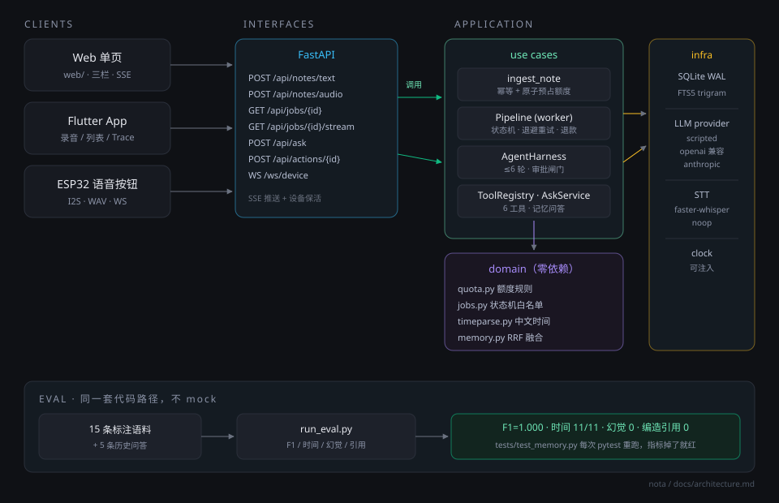
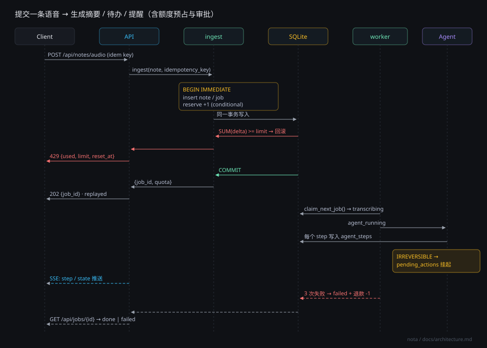
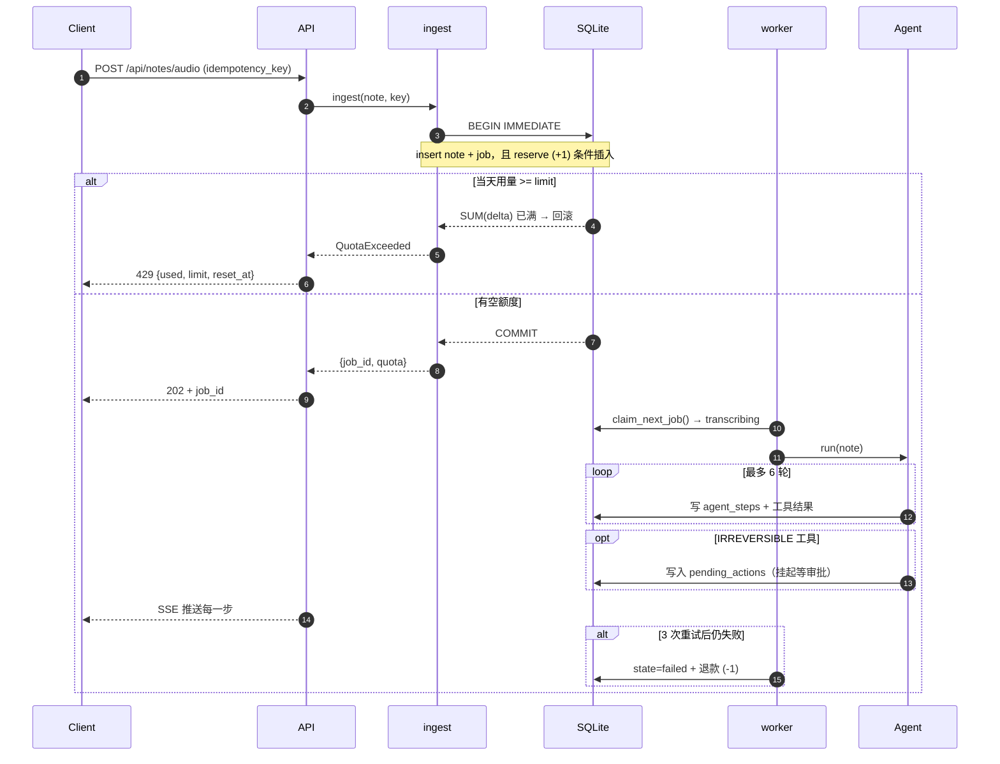

# 架构

## 一句话

一条语音进来，先落库、再占额度，然后异步走「转写 → Agent 循环 → 落结果」，全过程留痕；额度、幂等、审批三件事各自有独立的、可测试的落点。

## 总览



## 一次请求的时序





## 分层

```
interfaces/     FastAPI 路由、SSE、WebSocket、静态页     ← 唯一知道 HTTP 的地方
   ↓
application/    用例编排：ingest / pipeline / harness / tools / ask / quota
   ↓
domain/         纯逻辑：额度规则、状态机、时间解析、记忆排序   ← 不 import 任何框架
   ↓
infrastructure/ SQLite、LLM provider、STT、schema
```

`domain/` 里没有一个 `import fastapi`，`application/` 里也没有。这样做的直接好处：额度规则、状态机、时间解析都能用纯单元测试覆盖，不需要起服务、不需要 mock HTTP。

## 一次请求的完整路径

```
POST /api/notes/text  (或 /api/notes/audio)
  │
  ├─ 1. 查幂等键 ──── 命中 → 直接返回原 job（replayed=true，不扣额度）
  │
  ├─ 2. 单个写事务 ─┬─ INSERT notes
  │                 ├─ INSERT jobs (state=queued)
  │                 └─ INSERT usage_ledger (+1 reserve，条件插入)
  │                     └─ 超额 → 回滚整个事务 → 429 + reset_at
  │
  └─ 3. 返回 {job_id, quota}；后台 worker 被唤醒

worker:
  queued → transcribing ──(STT)──→ agent_running ──(harness)──→ done
                            │                        │
                            └────── 异常 ────────────┴──→ queued (退避重试，≤3 次)
                                                          └→ failed (+ 写一条 -1 退款)
```

关键点：**额度预占和任务创建在同一个事务里**。要么都成功，要么都不发生。这消除了「扣了额度但任务没建」和「任务建了但没扣额度」两种脏状态——它们正是 Part A / T6 里投诉的来源。

## Agent Harness

```
system prompt (时间/时区/套餐/工具清单/规则)
      │
      ▼
  ┌─ think ──→ 模型返回 tool_calls？
  │              │否 → 输出摘要，结束
  │              │是 ↓
  │           execute tool
  │              ├─ READ/WRITE  → 直接执行，结果回灌
  │              └─ IRREVERSIBLE → 写 pending_actions 挂起，回灌「待确认」
  │              ▼
  └──────── observe（最多 6 轮）
```

- 轮次上限 6，防止模型自我循环烧钱。
- 每一步都写 `agent_steps`（`assistant` / `tool_result`，含参数与结果原文），前端右栏就是读这张表。
- Provider 中立：`ChatModel` 只有 `complete()` 一个方法，`scripted` / `openai` / `anthropic` 三个实现走同一条 harness，没有 if-else 分支散落在业务代码里。

## 工具与风险等级

| 工具 | 风险 | 说明 |
|---|---|---|
| `list_todos` | READ | 无副作用 |
| `search_memory` | READ | 无副作用 |
| `create_todo` | WRITE | 可撤销（删掉即可） |
| `set_reminder` | WRITE | 可撤销 |
| `complete_todo` | WRITE | 可撤销 |
| `create_calendar_event` | **IRREVERSIBLE** | 邀请可能已发出去，必须人工确认 |

风险等级不是注释，是 `ToolRegistry.execute()` 里真的会拒绝执行 IRREVERSIBLE 的调用。

## 记忆与历史问答

两路召回，RRF 融合：

1. **词法**：SQLite FTS5 `trigram` 索引。中文没有空格，trigram 是少数能直接做子串匹配的方案。查询先过一遍疑问词剥离（`我是不是说过要买牛奶` → `买牛奶`），否则匹配到的是问句本身。
2. **语义**：字符 n-gram（n=2,3）哈希到 512 维向量做余弦相似度。确定性、零依赖、可替换（实现 `EmbeddingProvider` 就能换成真 embedding）。

融合后再乘一个轻微的时间衰减（半衰期 120 天），让「上个月那个报价」优先取近的。

**相关性下限**：RRF 永远会给出排名，哪怕语料完全不相关。所以最后按底层相似度过滤——词法没命中且语义相似度低于 0.12 的直接丢掉。没有这道闸，助手会给「火星殖民」引一条「买牛奶」的记录。

## 实时通道

| 通道 | 用途 | 为什么不用另一种 |
|---|---|---|
| SSE `/api/jobs/{id}/stream` | 网页看处理进度与工具调用 | 单向推送，比 WebSocket 简单，浏览器原生重连 |
| WebSocket `/ws/device` | 设备保活 + 下发到期提醒 | 设备需要双向（心跳上行、指令下行） |

## 失败与重试

- 退避 `1s / 4s / 15s`，最多 3 次，之后 `failed` 并退款。
- 重试前会清掉这条 note 已产生的 todos / memories，所以重试不会给用户堆出重复待办——这是「至少一次」语义下必须做的事。
- 每步 90 秒超时。

## 数据一致性

SQLite + WAL + `BEGIN IMMEDIATE`。所有写事务一开始就拿 RESERVED 锁，读-判-写不会被打断。这也是并发额度测试能过 50 线程的原因（`tests/test_quota.py`）。

单机之外要换 Postgres：把条件插入换成 `INSERT ... ON CONFLICT DO NOTHING` + 行级锁，账本表结构不用改。见 ADR-004。
